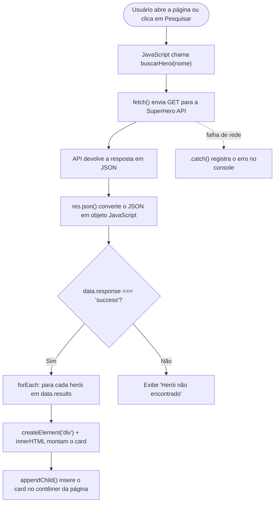

# Documentação teórica: consumo de API e manipulação do DOM

> Projeto **SuperHero**: site estático que exibe cards de super-heróis a partir da SuperHero API.
> Trabalho de **Web Development Front-End** · Aluna: Gabriela Rodrigues de Souza · Ciência da Computação 4 Semestre Noturno (UniFECAF)
> [← Voltar ao README](../README.md)

## Sumário

1. [O que é uma API e como funciona o consumo de dados em tempo real](#1-o-que-é-uma-api-e-como-funciona-o-consumo-de-dados-em-tempo-real)
2. [DOM manipulation e criação de elementos dinâmicos](#2-dom-manipulation-e-criação-de-elementos-dinâmicos)
3. [Funções básicas utilizadas](#3-funções-básicas-utilizadas)
4. [Por que escolhi a SuperHero API](#4-por-que-escolhi-a-superhero-api)
5. [Regras de acesso e documentação da API](#5-regras-de-acesso-e-documentação-da-api)
6. [Referências](#6-referências)

---

## 1. O que é uma API e como funciona o consumo de dados em tempo real

API (*Application Programming Interface*) é uma interface que define como um software pode solicitar dados ou serviços de outro, sem precisar conhecer sua implementação interna. No front-end, as mais usadas são as **APIs Web no padrão REST**: o servidor expõe *endpoints* (URLs), o cliente envia uma requisição HTTP (geralmente **GET**) e recebe uma resposta em **JSON**, um formato leve de texto com pares chave/valor.

O consumo em "tempo real" significa que os dados **não estão escritos no HTML**: eles são buscados no momento em que a página abre ou quando o usuário age (por exemplo, ao pesquisar um herói). Como a resposta leva um tempo para voltar, a requisição é **assíncrona**: o navegador continua funcionando enquanto espera.

Fluxo da aplicação:



## 2. DOM manipulation e criação de elementos dinâmicos

O **DOM** (*Document Object Model*) é a representação do HTML como uma árvore de objetos que o JavaScript consegue ler e modificar. **Manipular o DOM** é selecionar elementos existentes, alterar conteúdo ou estilo, e criar ou remover elementos, tudo com a página já aberta.

No projeto, o HTML tem apenas um contêiner vazio:

```html
<main id="heros-container"></main>
```

**Todos os cards são gerados pelo JavaScript**, um para cada personagem devolvido pela API, como pede o enunciado.

## 3. Funções básicas utilizadas

| Função / recurso | Para que serve no projeto |
|---|---|
| `fetch(url)` | Faz a requisição HTTP à API e retorna uma *Promise*. |
| `.then()` | Executa uma função quando a *Promise* é resolvida. Está encadeado duas vezes: primeiro converte a resposta, depois usa os dados. |
| `res.json()` | Lê o corpo da resposta e converte o texto JSON em objeto JavaScript. |
| `.catch()` | Trata falhas (por exemplo, internet fora do ar), evitando que o erro quebre a aplicação. |
| `forEach()` | Percorre `data.results` e monta um card para cada herói. |
| `createElement()` | Cria um novo elemento HTML na memória (`document.createElement('div')`). |
| `className` / `innerHTML` | Define a classe CSS do card e o conteúdo interno (imagem, nome, raça, gênero e poder). |
| `appendChild()` | Insere o card dentro do contêiner, tornando-o visível. |
| `addEventListener()` | Escuta o clique em *Pesquisar* e o evento `DOMContentLoaded` (carrega "Batman" ao abrir a página). |

Trecho principal do projeto ([`js/script.js`](../js/script.js)):

```javascript
fetch(`https://superheroapi.com/api.php/${TOKEN}/search/${nomeBusca}`)
  .then((res) => res.json())
  .then((data) => {
    if (data.response === 'success') {
      data.results.forEach(element => {
        const card = document.createElement('div')
        card.className = 'card'
        card.innerHTML = `
                          <h2>${element.name}</h2>
                          <p>Raça: ${element.appearance.race}</p>`
        container.appendChild(card)
      })
    }
  })
  .catch((err) => console.log(err))
```

## 4. Por que escolhi a SuperHero API

A SuperHero API reúne **mais de 700 personagens** de universos como Marvel e DC, com dados variados (atributos de poder, biografia, aparência, trabalho e conexões) e uma **busca por nome**, que combina bem com um site interativo. Os atributos numéricos (inteligência, força, velocidade, durabilidade, poder e combate) permitem cards com informações úteis além da foto. O tema também deu liberdade para criar uma identidade visual própria, com tons de roxo e magenta, cards escuros e efeito de brilho ao passar o mouse.

## 5. Regras de acesso e documentação da API

**Token de acesso.** A API é gratuita, mas exige um *access token* pessoal, obtido no site [superheroapi.com](https://superheroapi.com). O token faz parte da URL de todas as requisições: `https://superheroapi.com/api/{token}/...`. Como o projeto é um site estático, o token fica visível no código do navegador; em um sistema real, ele ficaria em um servidor (*back-end*) para não ser exposto.

**Endpoints.**

| Endpoint | Retorno |
|---|---|
| `/{id}` | Personagem completo |
| `/{id}/powerstats` | Atributos de poder |
| `/{id}/biography` | Biografia |
| `/{id}/appearance` | Aparência |
| `/{id}/work` | Trabalho |
| `/{id}/connections` | Conexões |
| `/{id}/image` | Imagem |
| `/search/{nome}` | Busca por nome (**usado neste projeto**) |

**Limite de requisições.** A documentação não divulga um limite numérico. Por isso o projeto faz uma requisição por busca, disparada apenas pelo clique do usuário ou pelo carregamento inicial.

**Estrutura da resposta.** A busca retorna um objeto JSON com o campo `response` (`"success"` ou `"error"`) e, em caso de sucesso, um array `results` com os personagens encontrados:

```json
{
  "response": "success",
  "results": [
    {
      "id": "644",
      "name": "Superman",
      "powerstats": { "intelligence": "100", "strength": "100", "power": "100" },
      "biography":  { "full-name": "Clark Kent", "publisher": "DC Comics" },
      "appearance": { "gender": "Male", "race": "Kryptonian" },
      "image":      { "url": "https://www.superherodb.com/pictures2/...jpg" }
    }
  ]
}
```

### Limitação encontrada nas imagens

A API devolve apenas o *endereço* da imagem, hospedada em `superherodb.com`, e esse servidor bloqueia o uso das fotos em outros sites (*hotlinking*), então os cards apareciam sem foto. Para resolver, mantive os dados da SuperHero API e passei a carregar as fotos de um espelho público no jsDelivr, montando o endereço a partir do `id` e do nome do herói. Também adicionei uma imagem de reserva, exibida caso alguma foto não carregue.

Esse caso mostra que o JSON pode estar correto e o recurso apontado por ele ainda assim ficar indisponível.

## 6. Referências

- MDN Web Docs. [Usando Fetch](https://developer.mozilla.org/pt-BR/docs/Web/API/Fetch_API/Using_Fetch)
- MDN Web Docs. [Document.createElement()](https://developer.mozilla.org/pt-BR/docs/Web/API/Document/createElement) e [Node.appendChild()](https://developer.mozilla.org/pt-BR/docs/Web/API/Node/appendChild)
- DEVMedia. [JavaScript Fetch](https://www.devmedia.com.br/javascript-fetch/41206)
- SuperHero API. [Documentação e endpoints](https://superheroapi.com)
- Material da disciplina Web Programming Front-End (AVA): Unidades I a IV (JSON, REST, fetch e DOM).
